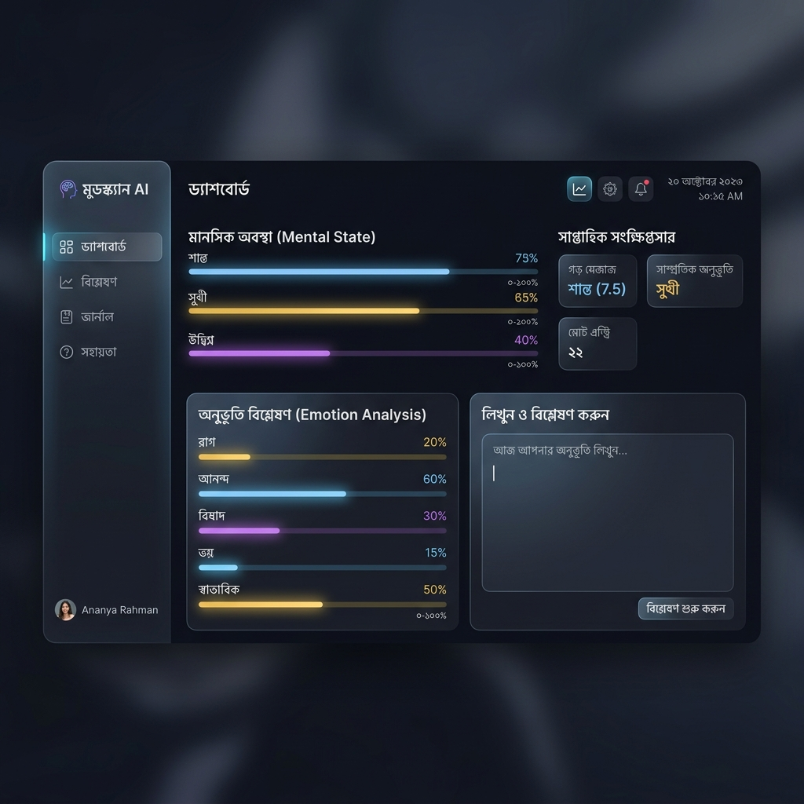
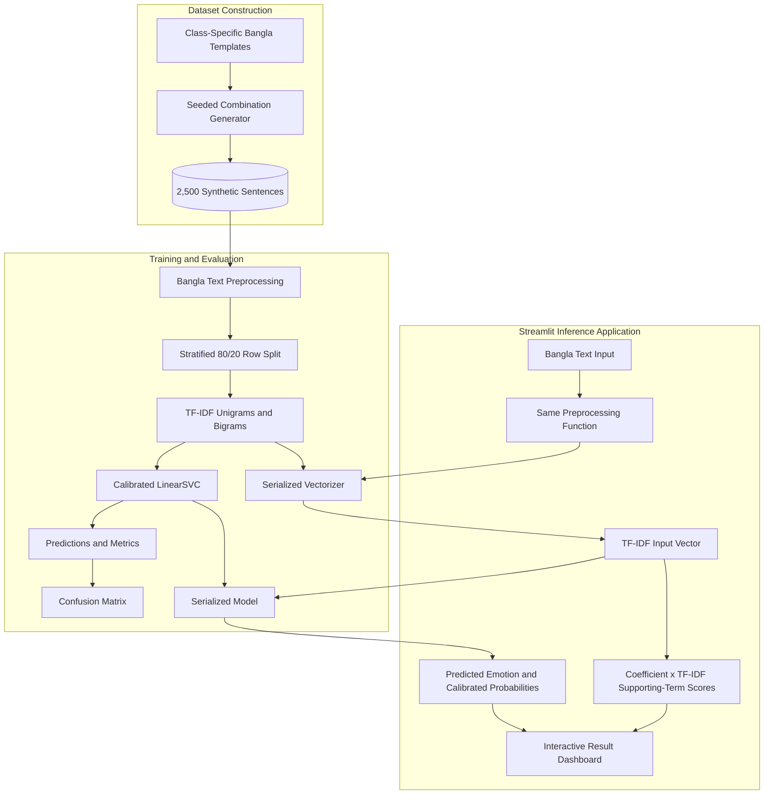
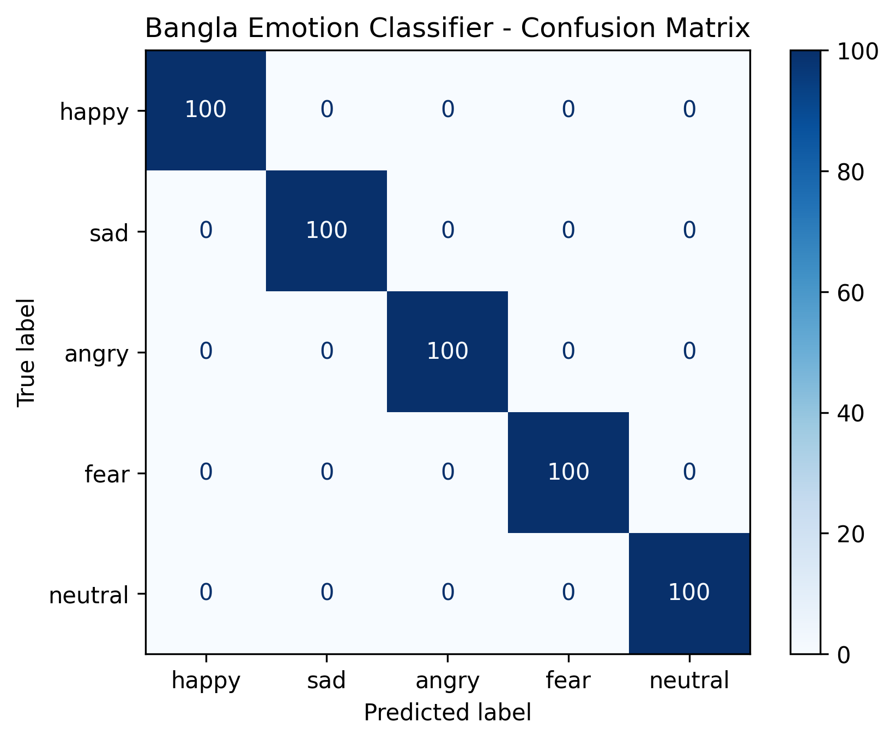

# Bangla Emotion Classification and Explanation Platform

> An educational Bangla NLP prototype for five-class emotion classification, calibrated confidence visualization, and interpretable lexical evidence.

[](https://www.python.org/)
[](https://scikit-learn.org/)
[](https://streamlit.io/)
[](https://plotly.com/python/)



## Overview

This repository contains an end-to-end educational NLP system that classifies Bangla text into five emotion categories:

- `happy`
- `sad`
- `angry`
- `fear`
- `neutral`

The project combines a reproducible template-based corpus generator, Bangla-aware text cleaning, TF-IDF unigram and bigram features, a calibrated Linear Support Vector Classifier, coefficient-based lexical explanations, and an interactive Streamlit dashboard.

The application performs genuine model inference locally: it loads the serialized vectorizer and classifier, transforms the submitted text, returns a predicted class and calibrated class probabilities, and visualizes the supporting terms found in the input.

> **Scope:** This is a controlled synthetic-data experiment and interface prototype. It is not a psychological assessment, clinical mental-state detector, or validated model for unrestricted real-world Bangla text.

---

## What Is Implemented

| Component | Implementation | Status |
|---|---|---|
| Corpus generation | Reproducible combinations of class-specific Bangla templates | Implemented |
| Preprocessing | Emoji/symbol removal, punctuation removal, whitespace normalization | Implemented |
| Feature extraction | TF-IDF word unigrams and bigrams | Implemented |
| Classification | Calibrated `LinearSVC` | Implemented |
| Probability display | `CalibratedClassifierCV.predict_proba` | Implemented |
| Lexical evidence | TF-IDF value multiplied by averaged linear coefficient | Implemented |
| Evaluation | Stratified random 80/20 split and confusion matrix | Implemented |
| Interface | Responsive dual-theme Streamlit application | Implemented locally |
| Vercel deployment | Static project landing page | Implemented |
| Streamlit deployment | Requires a separately configured Streamlit Community Cloud app | Deployment-dependent |
| Real-corpus validation | Evaluation on independently collected natural Bangla text | Not yet implemented |

---

## System Architecture



### Runtime Flow

```text
Bangla input
    |
    v
Text cleaning
    |
    v
Saved TF-IDF vectorizer
    |
    +--> Saved calibrated LinearSVC --> class probabilities
    |
    `--> Linear coefficients x TF-IDF --> supporting-term scores
    |
    v
Streamlit visualization and non-clinical guidance
```

---

## Dataset

### Current Experimental Corpus

The committed dataset is generated by `utils/download_dataset.py`. It uses class-specific lists of:

- subjects and noun phrases;
- intensity modifiers;
- emotion-bearing core phrases; and
- sentence endings.

The generator uses a fixed random seed and produces 500 unique combinations for each class.

| Class | Generated records |
|---|---:|
| Happy | 500 |
| Sad | 500 |
| Angry | 500 |
| Fear | 500 |
| Neutral | 500 |
| **Total** | **2,500** |

The committed CSV contains no exact duplicate rows.

### Relationship to UBMEC

The repository documentation references the [Unified Bangla Multi-class Emotion Corpus](https://github.com/Sakibsourav019/UBMEC-Unified-Bangla-Multi-class-Emotion-Corpus-) as domain inspiration. However, the committed training file is generated by this repository's template compiler; the current training script does not download, merge, or evaluate UBMEC records.

### Dataset Limitations

- The sentences are synthetic combinations, not naturally collected user statements.
- Each label uses its own emotion-specific vocabulary and endings.
- Random train/test splitting allows components from the same template families to appear in both partitions.
- Some generated combinations contain awkward subject-verb or phrase agreement.
- Perfectly balanced class counts do not represent natural emotion prevalence.
- The corpus does not cover sarcasm, mixed emotions, implicit emotion, dialect variation, code-mixing, spelling variation, or broader social context.

Therefore, this dataset is useful for verifying the software pipeline and studying a controlled classification setting, but it cannot establish real-world generalization.

---

## NLP and Modeling Pipeline

### Preprocessing

`utils/preprocessing.py` applies the same cleaning function during training and inference:

1. converts the input to text;
2. removes selected emoji, symbol, and pictograph ranges;
3. removes English and Bangla punctuation, including Dari characters; and
4. normalizes repeated whitespace.

The pipeline intentionally avoids stemming and aggressive normalization so the original Bangla lexical forms remain available to the TF-IDF model.

### Feature Extraction

The vectorizer is fitted only on the training partition:

```python
TfidfVectorizer(
    ngram_range=(1, 2),
    min_df=1
)
```

Unigrams capture individual terms, while bigrams capture short adjacent phrases.

### Classifier

The model uses a balanced linear support vector classifier wrapped in three-fold probability calibration:

```python
base_svc = LinearSVC(
    class_weight="balanced",
    random_state=42,
    max_iter=2000
)

model = CalibratedClassifierCV(
    estimator=base_svc,
    cv=3
)
```

The fitted vectorizer and classifier are saved with Joblib and loaded by the Streamlit application.

---

## Evaluation

The current experiment uses a stratified random split:

| Partition | Records | Records per class |
|---|---:|---:|
| Training | 2,000 | 400 |
| Testing | 500 | 100 |

### Current Result

The reproducible training script reports **100% accuracy on the 500-row synthetic holdout**.



| Actual / Predicted | Happy | Sad | Angry | Fear | Neutral |
|---|---:|---:|---:|---:|---:|
| Happy | 100 | 0 | 0 | 0 | 0 |
| Sad | 0 | 100 | 0 | 0 | 0 |
| Angry | 0 | 0 | 100 | 0 | 0 |
| Fear | 0 | 0 | 0 | 100 | 0 |
| Neutral | 0 | 0 | 0 | 0 | 100 |

### What the 100% Result Means

The score shows that the classifier separates unseen combinations created from the same class-specific template system. It does **not** show 100% accuracy on independently written Bangla sentences.

The result is expected because:

- emotional keywords are strongly associated with one class;
- class-specific sentence endings recur across generated combinations;
- training and test samples share template components; and
- TF-IDF can identify these lexical markers directly.

This evaluation should therefore be described as a **synthetic in-generator holdout**, not real-world validation.

---

## Interpretable Lexical Evidence

The application provides a transparent linear-model explanation rather than using SHAP.

For every nonzero term in the input vector, it calculates:

```text
supporting contribution = TF-IDF value x predicted-class coefficient
```

Because `CalibratedClassifierCV` contains estimators trained across calibration folds, the application averages their linear coefficient matrices before calculating the displayed contributions.

Only positive contributions toward the predicted class are currently displayed.

### Interpretation Boundary

These values indicate which recognized unigrams or bigrams support the model's predicted class. They:

- are not causal explanations;
- do not measure a person's psychological condition;
- do not explain contextual meaning beyond the linear feature representation;
- omit opposing or negative contributions; and
- should not be called SHAP values.

---

## Application Interface

The Streamlit application includes:

- Bangla text input;
- character and word counts;
- predicted emotion;
- calibrated confidence display;
- probability comparison across all five classes;
- supporting unigram/bigram contribution chart;
- bilingual plain-language explanation;
- dark and light themes;
- responsive layout; and
- an educational model scorecard.

### Dark-Theme Interface


The Vercel configuration serves `index.html` and the interface screenshot as a static landing page. The interactive Python application must run locally or through a separately configured Streamlit deployment.

---

## Technology Stack

| Area | Technologies |
|---|---|
| Programming | Python |
| Data handling | Pandas |
| NLP representation | scikit-learn TF-IDF |
| Classification | LinearSVC, CalibratedClassifierCV |
| Serialization | Joblib |
| Evaluation | scikit-learn, Matplotlib |
| Application | Streamlit |
| Interactive charts | Plotly |
| Static landing page | HTML, CSS, Vercel |

---

## Repository Structure

```text
AI-Assisted-Bangla-Emotional-State-Detection-Platform/
|-- app/
|   `-- app.py                       # Streamlit inference application
|-- data/
|   `-- raw/
|       `-- emotion_data.csv         # Generated five-class corpus
|-- models/
|   |-- emotion_model.joblib         # Calibrated LinearSVC artifact
|   |-- tfidf_vectorizer.joblib      # Fitted TF-IDF vectorizer
|   |-- confusion_matrix.png         # Synthetic holdout evaluation
|   `-- ui_screenshot.png            # Application screenshot
|-- utils/
|   |-- __init__.py
|   |-- download_dataset.py          # Seeded template corpus generator
|   `-- preprocessing.py             # Shared Bangla text cleaning
|-- index.html                       # Static project landing page
|-- requirements.txt                 # Python dependencies
|-- train.py                         # Training and evaluation pipeline
|-- vercel.json                      # Static Vercel configuration
`-- README.md
```

This tree uses ASCII characters to avoid encoding problems in GitHub rendering.

---

## Local Setup

### Prerequisites

- Python 3.10 or newer
- Git

### 1. Clone the Repository

```bash
git clone https://github.com/anushka06onu/AI-Assisted-Bangla-Emotional-State-Detection-Platform.git
cd AI-Assisted-Bangla-Emotional-State-Detection-Platform
```

### 2. Create a Virtual Environment

```bash
python -m venv .venv
```

Activate it:

```bash
# Linux or macOS
source .venv/bin/activate

# Windows PowerShell
.venv\Scripts\Activate.ps1
```

### 3. Install Dependencies

```bash
pip install -r requirements.txt
```

### 4. Optional: Regenerate the Synthetic Corpus

```bash
python utils/download_dataset.py
```

This overwrites `data/raw/emotion_data.csv` with a reproducible, seeded template-generated dataset.

### 5. Train and Evaluate

```bash
python train.py
```

This generates or replaces:

- `models/emotion_model.joblib`
- `models/tfidf_vectorizer.joblib`
- `models/confusion_matrix.png`

### 6. Start the Interactive Application

```bash
streamlit run app/app.py
```

Streamlit will print the local application address, normally:

```text
http://localhost:8501
```

---

## Recommended Research Improvements

The highest-value next step is evaluation on natural, independently authored Bangla text—not generating more templates.

- [ ] Train and evaluate on a documented real-world Bangla emotion corpus.
- [ ] Keep the original corpus license, citation, and label definitions.
- [ ] Create train, validation, and test partitions that prevent author or source leakage.
- [ ] Reserve a manually reviewed external test set written independently of the templates.
- [ ] Compare word TF-IDF, character n-grams, Logistic Regression, LinearSVC, and a Bangla transformer baseline.
- [ ] Report macro precision, recall, F1, per-class metrics, and confusion matrices.
- [ ] Evaluate code-mixed Bangla-English text, spelling variation, dialect, negation, and sarcasm.
- [ ] Add out-of-distribution or low-confidence handling instead of always returning one of five emotions.
- [ ] Display both supporting and opposing linear contributions.
- [ ] Add automated preprocessing, inference, and artifact-loading tests.
- [ ] Remove unsupported “flawless,” “professional-grade,” and “state-of-the-art” claims from the interface itself.

---

## Intended Use and Limitations

This project is suitable for:

- learning Bangla NLP workflows;
- demonstrating TF-IDF and linear classification;
- experimenting with probability calibration;
- studying simple feature-level model interpretation; and
- prototyping an accessible bilingual ML interface.

It is not suitable for:

- diagnosis or psychological assessment;
- determining a person's wellbeing or safety;
- treatment or medical decision-making;
- monitoring people without their knowledge; or
- claiming broad generalization to natural Bangla communication.

The interface provides general supportive text for demonstration purposes only. Model output should not be treated as professional advice.

---

## What This Project Demonstrates

- A reproducible text-data generation workflow.
- Shared preprocessing between model training and application inference.
- TF-IDF unigram and bigram representation for Bangla text.
- Calibrated multiclass linear classification.
- Model serialization and runtime loading.
- Feature-level inspection of a linear NLP model.
- Interactive visualization and bilingual interface development.
- Awareness of the difference between synthetic holdout performance and real-world validity.

---

## Author

Developed by [Fateha Hossain Anushka](https://fatehahossainanushka.vercel.app/)
